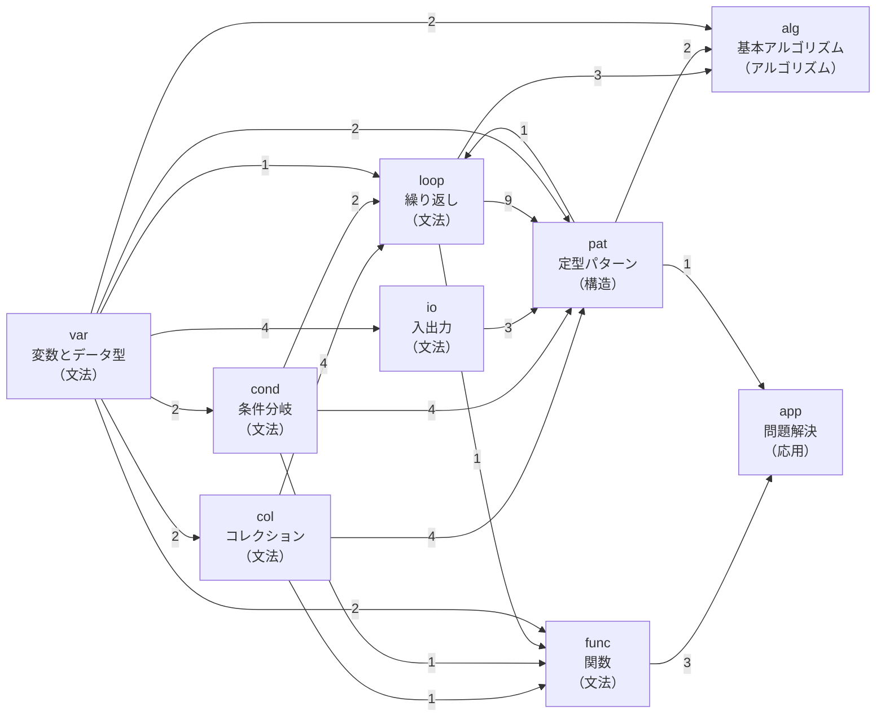

# 知識グラフ一覧（自動生成）

`uv run python -m tools.edu_content graph-doc content/` で `content/` の YAML から生成した一覧（2026-10-21）。**このファイルは直接編集しない。** 設計方針は `docs/knowledge_graph.md` を参照。

## 概要

| 項目 | 数 |
| --- | --- |
| トピック | 9 |
| 知識点 | 62（文法 45・構造 11・アルゴリズム 3・応用 3） |
| 関係 | 106（先修 92・関連 7・混同エラー 7） |
| 単元 | 14（うちトピック単元 9） |

## トピック間の先修関係

矢印は「左のトピックの知識点が、右のトピックの知識点の前提になっている」ことを表す（数字は関係の数）。

## 知識点

「講義」「問題」は現在の教材の数（問題は主知識点として数えたもの）。

### alg：基本アルゴリズム

| ID | 知識点 | 層 | 難易度 | 前提 | 講義 | 問題 |
| --- | --- | --- | --- | --- | --- | --- |
| alg_01 | 素数判定 | アルゴリズム | 5 | pat_06, loop_02, var_02 | — | — |
| alg_02 | 最大公約数（ユークリッドの互除法） | アルゴリズム | 5 | loop_11, var_02 | — | — |
| alg_03 | バブルソート | アルゴリズム | 6 | pat_09, loop_08 | — | — |

### app：問題解決

| ID | 知識点 | 層 | 難易度 | 前提 | 講義 | 問題 |
| --- | --- | --- | --- | --- | --- | --- |
| app_01 | 仕様から入出力を設計する | 応用 | 5 | pat_11 | — | — |
| app_02 | 処理を関数に分割する | 応用 | 6 | func_03, func_07 | — | — |
| app_03 | テストケースで確かめる | 応用 | 5 | func_03 | — | — |

### col：コレクション

| ID | 知識点 | 層 | 難易度 | 前提 | 講義 | 問題 |
| --- | --- | --- | --- | --- | --- | --- |
| col_01 | リストの作成とインデックス | 文法 | 1 | var_01 | — | — |
| col_02 | リストの操作（append・remove・pop・len） | 文法 | 2 | col_01 | — | 1 |
| col_03 | リストのスライス | 文法 | 2 | col_01 | — | — |
| col_04 | 組み込み関数と in（sum・max・min・sorted） | 文法 | 2 | col_01 | — | — |
| col_05 | タプルとアンパック | 文法 | 2 | col_01 | — | — |
| col_06 | 辞書の作成・参照・更新 | 文法 | 2 | var_01 | — | — |
| col_07 | 辞書のメソッド（keys・values・items・get） | 文法 | 3 | col_06 | — | — |
| col_08 | 集合 | 文法 | 3 | col_01 | — | — |
| col_09 | 2次元リスト | 文法 | 4 | col_01 | — | — |

### cond：条件分岐

| ID | 知識点 | 層 | 難易度 | 前提 | 講義 | 問題 |
| --- | --- | --- | --- | --- | --- | --- |
| cond_01 | if 文 | 文法 | 1 | var_04 | — | — |
| cond_02 | else と elif | 文法 | 2 | cond_01 | — | — |
| cond_03 | 論理演算（and・or・not） | 文法 | 2 | var_04 | — | — |
| cond_04 | 条件分岐のネスト | 文法 | 3 | cond_02 | — | — |

### func：関数

| ID | 知識点 | 層 | 難易度 | 前提 | 講義 | 問題 |
| --- | --- | --- | --- | --- | --- | --- |
| func_01 | 関数の定義と呼び出し | 文法 | 2 | var_01 | — | — |
| func_02 | 引数 | 文法 | 2 | func_01 | — | — |
| func_03 | 戻り値（return と print の違い） | 文法 | 3 | func_02 | — | — |
| func_04 | デフォルト引数・キーワード引数 | 文法 | 3 | func_03 | — | — |
| func_05 | 変数のスコープ | 文法 | 4 | func_01, var_01 | — | — |
| func_06 | 組み込み関数とモジュールの import | 文法 | 2 | func_01 | — | — |
| func_07 | リストを受け取る・返す関数 | 文法 | 4 | func_03, col_01, loop_01 | — | — |
| func_08 | 再帰の仕組み | 文法 | 6 | func_03, cond_02 | — | — |

### io：入出力

| ID | 知識点 | 層 | 難易度 | 前提 | 講義 | 問題 |
| --- | --- | --- | --- | --- | --- | --- |
| io_01 | print の基本（複数の値・sep・end） | 文法 | 1 | var_01 | — | — |
| io_02 | input（入力は常に文字列） | 文法 | 1 | var_03 | — | — |
| io_03 | 入力値を数値に変換する | 文法 | 2 | io_02, var_05 | — | — |
| io_04 | f 文字列による整形出力 | 文法 | 2 | io_01 | — | — |
| io_05 | 1行の複数の値を読む（split と map） | 文法 | 3 | io_03, var_08 | — | — |

### loop：繰り返し

| ID | 知識点 | 層 | 難易度 | 前提 | 講義 | 問題 |
| --- | --- | --- | --- | --- | --- | --- |
| loop_01 | for文の基本構文 | 文法 | 1 | col_01 | 1 | 20 |
| loop_02 | range と決まった回数の繰り返し | 文法 | 2 | loop_01 | 1 | 15 |
| loop_03 | range のステップ | 文法 | 2 | loop_02 | 1 | 5 |
| loop_04 | 文字列のループ | 文法 | 2 | loop_01, var_03 | 1 | 5 |
| loop_05 | 辞書と for 文 | 文法 | 3 | loop_01, col_07 | 1 | 10 |
| loop_06 | enumerate | 文法 | 3 | loop_01, col_05 | 1 | 5 |
| loop_07 | zip | 文法 | 3 | loop_01, col_05 | 1 | 5 |
| loop_08 | 二重ループ | 文法 | 4 | loop_02 | 1 | 10 |
| loop_09 | break と continue | 文法 | 3 | loop_01, cond_01 | 1 | 10 |
| loop_10 | リスト内包表記 | 文法 | 4 | pat_05 | 1 | 3 |
| loop_11 | while 文 | 文法 | 2 | cond_01, loop_01 | 1 | 10 |

### pat：定型パターン

| ID | 知識点 | 層 | 難易度 | 前提 | 講義 | 問題 |
| --- | --- | --- | --- | --- | --- | --- |
| pat_01 | 累積（合計・平均） | 構造 | 2 | loop_01, var_06 | 1 | 15 |
| pat_02 | カウント（条件を満たす個数） | 構造 | 2 | pat_01, cond_01 | — | 1 |
| pat_03 | 最大値・最小値の更新 | 構造 | 3 | loop_01, cond_01 | 1 | 5 |
| pat_04 | フィルタ（条件を満たす要素を集める） | 構造 | 3 | loop_01, cond_01, col_02 | — | 3 |
| pat_05 | 変換（各要素を加工して新しいリストを作る） | 構造 | 3 | loop_01, col_02 | 1 | 6 |
| pat_06 | 探索（見つけたら止める） | 構造 | 3 | loop_09, cond_01 | — | — |
| pat_07 | 辞書による集計（頻度・グループ別合計） | 構造 | 4 | col_07, pat_02 | — | — |
| pat_08 | 全組み合わせの生成 | 構造 | 4 | loop_08, loop_02 | — | — |
| pat_09 | 前の要素との比較 | 構造 | 4 | loop_01, col_01 | — | — |
| pat_10 | 区切り付きの文字列の組み立て | 構造 | 3 | loop_01, var_08, io_01 | — | — |
| pat_11 | 入力→処理→出力の基本形 | 構造 | 2 | io_03, io_05 | — | — |

### var：変数とデータ型

| ID | 知識点 | 層 | 難易度 | 前提 | 講義 | 問題 |
| --- | --- | --- | --- | --- | --- | --- |
| var_01 | 変数と代入 | 文法 | 1 | — | — | — |
| var_02 | 数値型（int・float）と算術演算 | 文法 | 1 | var_01 | — | — |
| var_03 | 文字列の基本（連結・繰り返し・len） | 文法 | 1 | var_01 | — | — |
| var_04 | bool と比較演算 | 文法 | 1 | var_01 | — | — |
| var_05 | 型変換（int・float・str） | 文法 | 2 | var_02, var_03 | — | — |
| var_06 | 複合代入演算子（+= など） | 文法 | 1 | var_02 | — | — |
| var_07 | 文字列のインデックスとスライス | 文法 | 2 | var_03 | — | — |
| var_08 | 文字列メソッド（split・join・replace など） | 文法 | 3 | var_07 | — | — |

## 単元

「単元の講義・問題」は単元そのものに付けた教材（総合演習など）の数。範囲内の知識点の教材は含まない。

| ID | 単元 | 範囲 | 知識点数 | 単元の講義 | 単元の問題 |
| --- | --- | --- | --- | --- | --- |
| u_calc | 計算プログラム | トピック var, io ＋ pat_11 | 14 | — | — |
| u_func_pat | 関数で書くパターン | func_01, func_02, func_03, func_07, pat_01, pat_02, pat_03, pat_04, pat_05, pat_06, pat_07 | 11 | — | — |
| u_loop_col | for文とコレクション | トピック loop, col ＋ pat_04, pat_05, pat_07 | 23 | — | — |
| u_loop_for | for文 総合演習 | loop_01, loop_02, loop_03, loop_04, loop_05, loop_06, loop_07, loop_08, loop_09, loop_10, pat_01, pat_02, pat_03, pat_04, pat_05, pat_06, pat_08 | 17 | 1 | 15 |
| u_midterm | 前半まとめ（中間テスト範囲） | トピック var, io, cond, col, loop, pat | 48 | — | — |
| alg | 基本アルゴリズム（自動） | トピック alg | 3 | — | — |
| app | 問題解決（自動） | トピック app | 3 | — | — |
| col | コレクション（自動） | トピック col | 9 | — | — |
| cond | 条件分岐（自動） | トピック cond | 4 | — | — |
| func | 関数（自動） | トピック func | 8 | — | — |
| io | 入出力（自動） | トピック io | 5 | — | — |
| loop | 繰り返し（自動） | トピック loop | 11 | — | — |
| pat | 定型パターン（自動） | トピック pat | 11 | — | — |
| var | 変数とデータ型（自動） | トピック var | 8 | — | — |

## 混同エラー・関連

| 種類 | 知識点 | 知識点 | 説明 |
| --- | --- | --- | --- |
| 関連 | col_03 | var_07 | 文字列とリストのスライスは同じ規則 |
| 混同エラー | func_03 | io_01 | return と print を混同する（戻り値が None になる） |
| 関連 | func_05 | var_01 | スコープは「変数」の概念を関数の中に広げたもの |
| 関連 | func_06 | col_04 | sum・max なども組み込み関数 |
| 混同エラー | io_02 | var_05 | input の結果を数値に変換し忘れる（TypeError や文字列の連結になる） |
| 関連 | io_04 | var_03 | f 文字列は文字列の組み立て方の一つ |
| 混同エラー | loop_02 | col_03 | range もスライスも終点を含まない |
| 混同エラー | loop_08 | loop_09 | 二重ループ内の break は内側のループだけを抜ける |
| 混同エラー | loop_09 | loop_11 | while 内の continue でカウンタ更新が飛ばされ無限ループになる |
| 関連 | loop_04 | var_07 | 文字列の各文字へのアクセス |
| 関連 | loop_10 | pat_04 | 条件つき内包表記はフィルタの短縮形 |
| 混同エラー | pat_01 | pat_03 | 初期化の位置（ループの中に書く）や初期値（最大値を 0 で初期化）の誤り |
| 混同エラー | pat_01 | loop_01 | 累積や print のインデントがずれてループの中・外を取り違える |
| 関連 | pat_07 | var_08 | 単語の頻度は split で分割してから集計する |
